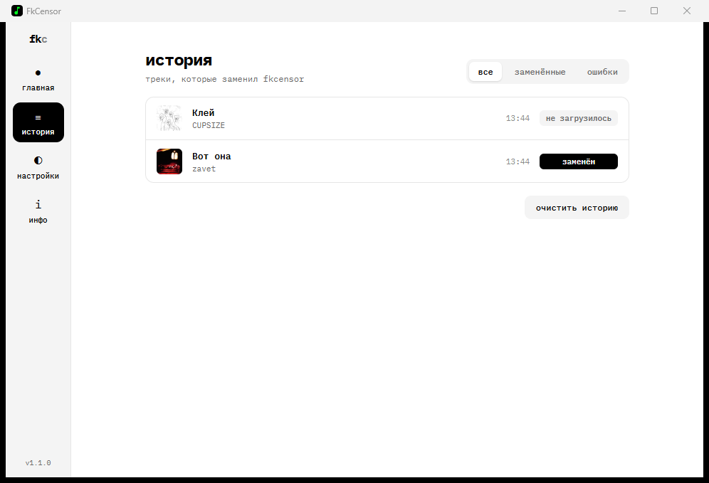

# FkCensor (Обход цензуры Яндекс Музыка)

Патчер Яндекс Музыки, который заменяет зацензуренные и недоступные треки на оригинальные версии.

## Что умеет

- **Заменяет звук**: зацензуренные версии треков играют без запикивания.
- **Возвращает недоступные треки**: удалённые и заблокированные треки, для которых есть замена, снова отображаются и играют как обычные.
- **Исправляет информацию о треках**: названия, обложки, трек-листы альбомов, а перезалитые треки и альбомы появляются на страницах настоящих исполнителей.
- **Ставится на паузу мгновенно**: без удаления патча и перезапуска Яндекс Музыки.
- **Показывает историю и статистику**: какие треки заменены, что играет прямо сейчас, что не удалось загрузить.

## Как это работает

FkCensor встраивает скрипт в приложение Яндекс Музыки. Скрипт подменяет звук и информацию о треках прямо внутри клиента, а программа FkCensor живёт в трее: включает и выключает подмену, ведёт историю и следит за патчем. Подмена работает, пока FkCensor запущен. Если закрыть программу, Яндекс Музыка играет обычные версии треков.

Список замен загружается автоматически из [FckCensorData](https://github.com/Hazzz895/FckCensorData) и обновляется каждые 10 минут.

## Установка

1. Скачай последний релиз из [Releases](https://github.com/S4YN3X/FkCensor/releases)
2. Запусти `FkCensor.exe` — откроется окно программы, а в трее появится иконка
3. На главной нажми **установить**
4. Яндекс Музыка перезапустится автоматически

FkCensor сам находит Яндекс Музыку в `%LOCALAPPDATA%\Programs`. Если она установлена в другое место, укажи папку в **настройках**.

Окно можно закрыть: программа продолжит работать в трее. Чтобы она запускалась вместе с Windows, включи **запуск вместе с windows** в настройках.

## Удаление патча

**Настройки** → **удалить патч**. Яндекс Музыка перезапустится с оригинальными файлами.

## Поддерживаемые платформы

| Платформа | Статус |
|-----------|--------|
| Windows   | ✅ |
| macOS     | ❌ |
| Linux     | ❌ |

## Частые вопросы

**Яндекс Музыка не запускается после патча**  
Открой FkCensor. Если на главной написано «патч повреждён», нажми **восстановить**. Если это не помогло — **настройки** → **удалить патч**, затем установи его заново.

**Трек всё равно недоступен или звучит с цензурой**  
Трек может ещё не быть в базе замен. База пополняется — проверь позже. Также проверь, что FkCensor запущен и не стоит на паузе.

**Замены не загружаются**  
Файлы замен лежат на GitHub, а его иногда блокируют. В этом случае FkCensor включает зацензуренную версию и показывает уведомление. Помогает VPN.

**Обновилась Яндекс Музыка и патч слетел**  
FkCensor это заметит: на главной появится «патч не установлен» или «патч устарел». Нажми **установить** или **обновить**.

**Окно программы не открывается**  
Для окна нужен Microsoft Edge WebView2. В Windows 11 он уже есть, в Windows 10 его можно [скачать у Microsoft](https://developer.microsoft.com/microsoft-edge/webview2/).

## Дисклеймер

Проект создан в образовательных целях. Используй на свой страх и риск.

Данная модификация не даёт возможность пользоваться сервисом без подписки Яндекс Плюс

[Лицензия](LICENSE)
