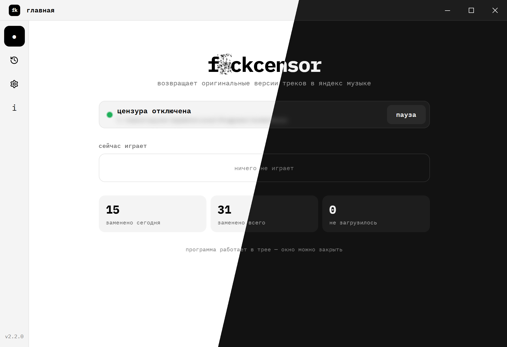

# F_ckCensor (Обход цензуры Яндекс Музыки)

Программа для Яндекс Музыки, которая возвращает оригинальные версии зацензуренных треков, а удалённые треки и альбомы — обратно в каталог.

## Что умеет

- **Заменяет звук**: зацензуренные версии треков играют без запикивания.
- **Возвращает удалённое**: недоступные треки и даже целиком удалённые альбомы снова открываются, играют и стоят на страницах исполнителей среди остальных релизов.
- **Исправляет информацию**: названия, обложки, исполнителей и трек-листы альбомов.
- **Даёт подменить самому**: в меню «⋯» любого трека и альбома есть пункт «Подменить». Можно подставить свой аудиофайл, поменять название и обложку, собрать трек-лист альбома и добавить в него свои треки.
- **Помечает подменённое**: рядом с названием появляется значок, как у меток Яндекс Музыки.
- **Принимает сообщения о цензуре**: кнопка «Сообщить о цензуре» в окне подмены отправляет трек на проверку, и после неё он подменяется у всех.
- **Ставится на паузу мгновенно**: без удаления патча и перезапуска Яндекс Музыки.
- **Обновляется сама**: при запуске проверяет новую версию, скачивает её и перезапускается.
- **Ведёт историю и статистику**: что играло, что заменено, что не загрузилось.

## Как это работает

F_ckCensor встраивает скрипт в приложение Яндекс Музыки. Скрипт подменяет звук и данные о треках прямо внутри клиента, а сама программа живёт в трее: включает и выключает подмену, ведёт историю и следит за патчем. Подмена работает, пока F_ckCensor запущен. Если закрыть программу, Яндекс Музыка играет обычные версии треков.

Список замен загружается автоматически из [FkCensorData](https://github.com/fcensor-data/FkCensorData) (в него входит и база [FckCensorData](https://github.com/Hazzz895/FckCensorData)) и обновляется каждые 10 минут. Свои подмены хранятся только у тебя в Яндекс Музыке и на другие устройства не попадают.

## Установка

1. Скачай `F_ckCensor.exe` из [последнего релиза](https://github.com/S4YN3X/F_ckCensor/releases/latest)
2. Запусти его — откроется окно программы, а в трее появится иконка
3. На главной нажми **установить**
4. Яндекс Музыка перезапустится автоматически

F_ckCensor сам находит Яндекс Музыку в `%LOCALAPPDATA%\Programs`. Если она установлена в другое место, укажи папку в **настройках**.

Окно можно закрыть: программа продолжит работать в трее. Чтобы она запускалась вместе с Windows, включи **запуск вместе с windows** в настройках — тогда она стартует незаметно, в трее, а окно покажет только если патчу нужно внимание.

## Удаление

1. **Настройки** → **удалить патч** — Яндекс Музыка перезапустится с оригинальными файлами
2. Выключи **запуск вместе с windows** и закрой программу через меню в трее
3. Удали `F_ckCensor.exe` и папку `%LOCALAPPDATA%\F_ckCensor` с настройками и историей

## Поддерживаемые платформы

| Платформа | Статус |
|-----------|--------|
| Windows 10/11 | ✅ |
| Android, iOS | Частично* |
| macOS     | ❌ |
| Linux     | ❌ |

\* На телефоне сама программа не работает, но слушать без цензуры можно. На компьютере откройте «Мне нравится» или альбом и нажмите кнопку со звёздочкой «Собрать без цензуры». В вашей Яндекс Музыке появится плейлист с версиями без цензуры, он играет и на телефоне. Новые лайки попадают в него, когда вы снова нажмёте «Собрать» на компьютере.

## Частые вопросы

<b>Трек всё равно звучит с цензурой или недоступен</b>

Трека может ещё не быть в базе замен — она постоянно пополняется. Нажми «⋯» у трека → **Подменить трек** → **Сообщить о цензуре**, и после проверки он будет подменяться у всех. Если есть свой файл без цензуры, подставь его там же кнопкой **Подменить аудио**.

Также проверь, что F_ckCensor запущен и не стоит на паузе.

<b>Как подменить альбом или добавить в него свой трек</b>

Нажми «⋯» у альбома → **Подменить альбом**. В окне подмены можно поменять название, обложку и исполнителей, переставить и убрать треки, добавить треки поиском или по ссылке. Кнопка **Добавить трек** → **Свой файл** добавляет в альбом трек из твоего аудиофайла — с названием и, если нужно, дополнительным исполнителем.

<b>Яндекс Музыка не запускается после патча</b>

Открой F_ckCensor. Если на главной написано «патч повреждён», нажми **восстановить**. Если это не помогло — **настройки** → **удалить патч**, затем установи его заново.

<b>Яндекс Музыка обновилась, и патч слетел</b>

F_ckCensor это заметит сам: на главной появится «патч не установлен» или «патч устарел» — нажми **установить** или **обновить**. Если программа работает в трее, она откроет окно свёрнутым на панели задач, чтобы ты не пропустил.

<b>Замены не загружаются</b>

Файлы замен лежат на GitHub, а его иногда блокируют. Пока он недоступен, Яндекс Музыка играет обычные версии треков, а на главной появится предупреждение. Помогает VPN.

<b>Как обновить программу</b>

Ничего делать не нужно: при запуске F_ckCensor сам проверяет новую версию, скачивает её и перезапускается. Если программа стоит в автозапуске, обновление проходит в фоне. Отключить это можно в настройках — **проверка обновлений**.

<b>Окно программы не открывается</b>

Для окна нужен Microsoft Edge WebView2. В Windows 11 он уже есть, в Windows 10 его можно [скачать у Microsoft](https://developer.microsoft.com/microsoft-edge/webview2/).

<b>Интерфейс слишком мелкий или крупный</b>

**Настройки** → **масштаб интерфейса**: от 100 до 200% поверх масштаба Windows. Там же можно выбрать тему и выключить анимации.

## Благодарности

[FckCensor](https://github.com/Hazzz895/FckCensor) и [FckCensorData](https://github.com/Hazzz895/FckCensorData) от Hazzz895 — база замен и идеи подмены треков и альбомов.

## Правообладателям

Если в базе замен есть ваше произведение и вы против — [оставьте заявку](https://fcensor-data.github.io/), его удалят из базы, как правило, в течение 3 дней.

## Дисклеймер

Проект создан в образовательных целях. Используй на свой страх и риск.

Программа не даёт пользоваться Яндекс Музыкой без подписки Яндекс Плюс.

[Лицензия](LICENSE)
